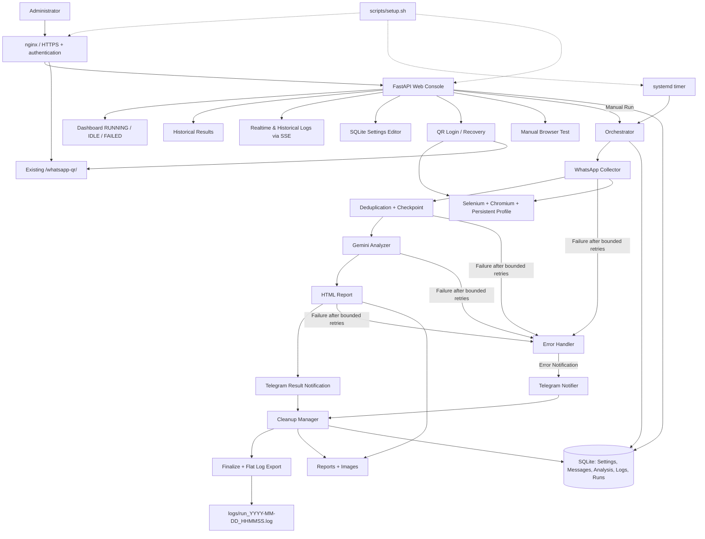

# WhatsAppReader 2.0 — Agreed Module Architecture

The new design does **not** copy the PowerShell module layout. It keeps business rules, tested DOM scripts and the existing Oracle Cloud browser profile.

## Runtime behavior

- One scheduled full run; retry counts are per operation, never unbounded.
- New message collection advances the checkpoint only after durable data storage.
- `api_error` analysis is recorded while the message stays `PENDING_AI`, then the run fails and Telegram is called.
- Cleanup is invoked in a `finally` block, including after failures.
- Data retention policies are independent but preserve required dependencies (pending messages, checkpoints and related data).
- Web UI runs continuously behind the existing nginx HTTPS server.
- Runtime settings including topic and Gemini prompts live in SQLite and are editable through the Web Console; schema and generic defaults live in `settings.py`. Machine paths are configured in `app.yaml`; secrets in `/etc/whatsappreader.env`.
- No automatic separate Selenium compatibility tests; Chromium Snap manages browser updates.
- No scheduled backup service for SQLite, messages, logs, or generated reports; Git is used for source control only.

## Deployment concerns

- The OCI VM, nginx, profile and SSL certificate are existing infrastructure and must not be replaced.
- Installation and actual DOM/API behavior require validation on the target VM. Local tests do not exercise WhatsApp Web or real Gemini/Telegram API responses.
